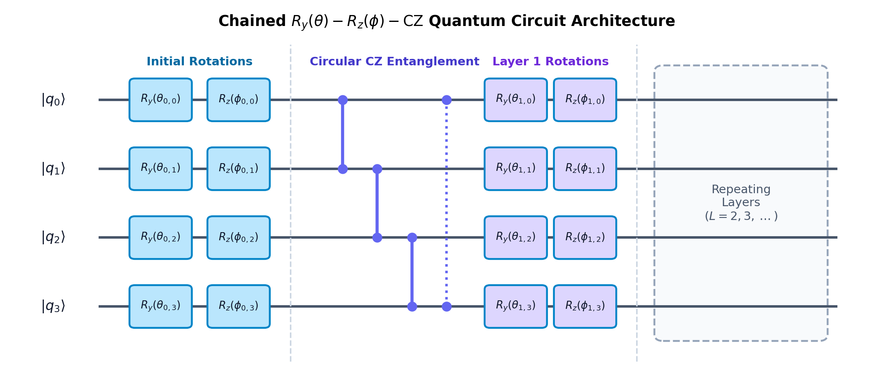

# Tutorial: Building & Benchmarking Custom Quantum Ansatze

In quantum algorithm research, the choice and design of the parameterized quantum circuit (ansatz) dictates the solution accuracy, expressive power, and trainability landscape. `qpdesolver` provides an open, highly extensible ansatz subsystem designed specifically for academic experimentation.

This guide explains how to design, register, and evaluate your own custom ansatz templates.

---

## 1. The `Ansatz` Base Architecture

All ansätze in `qpdesolver` derive from the abstract base class [`Ansatz`](../src/qpdesolver/ansatze/base.py).

### 1.1. Required Interface Methods

| Method / Property | Signature | Purpose |
|:---|:---|:---|
| `num_params(n_qubits)` | `(int) -> int` | Returns total parameter count for an $n$-qubit system. |
| `apply(params, wires)` | `(Sequence[float], Sequence[int]) -> None` | PennyLane circuit operations defining the unitary $U(\theta)$. |
| `with_layers(layers)` | `(int) -> Ansatz` | Returns a new ansatz instance with the specified number of layers (used by `LayerwiseTrainer`). |
| `generators(n_qubits)` | `(int) -> Optional[List[str]]` | Returns Pauli string generator labels (e.g. `["IX", "ZI"]`) for computing the Dynamical Lie Algebra (DLA). |
| `layer_param_slices(n_qubits)`| `(int) -> List[slice]` | Returns parameter index ranges per layer. |

---

## 2. Approach 1: Subclassing `Ansatz` (Recommended for Research)

Subclassing `Ansatz` provides complete control over layer scaling, Lie algebra generators, and integration into the global registry.

### Complete Example: Chained $R_y(\theta) - R_z(\phi) - \text{CZ}$ Entangling Ansatz

Suppose you want to research a custom ansatz consisting of:
1. An initial rotation layer of $R_y(\theta_j) R_z(\phi_j)$ on all qubits.
2. $L$ repeating entangling blocks of circular $\text{CZ}$ gates followed by another rotation layer.



Here is the complete implementation:

```python
from typing import Sequence, List, Optional
import pennylane as qml

from qpdesolver.ansatze.base import Ansatz
from qpdesolver.core.registry import REGISTRY_ANSATZE

@REGISTRY_ANSATZE.register("chained_ry_rz_cz")
class ChainedRyRzCZAnsatz(Ansatz):
    """
    Custom Research Ansatz:
    Alternating Ry-Rz single-qubit rotations with circular CZ entangling gates.
    """
    def __init__(self, layers: int = 2):
        self.name = "chained_ry_rz_cz"
        self.layers = layers

    def num_params(self, n_qubits: int) -> int:
        # 2 parameters per qubit for initial layer + 2 parameters per qubit per layer
        return 2 * n_qubits * (self.layers + 1)

    def apply(self, params: Sequence[float], wires: Sequence[int]) -> None:
        n_q = len(wires)
        idx = 0

        # Initial single-qubit rotation layer
        for w in wires:
            qml.RY(params[idx], wires=w); idx += 1
            qml.RZ(params[idx], wires=w); idx += 1

        # Repeating entangling blocks
        for l in range(self.layers):
            # Circular CZ entangling gates
            for i in range(n_q):
                target = (i + 1) % n_q
                qml.CZ(wires=[wires[i], wires[target]])

            # Parameterized rotation layer
            for w in wires:
                qml.RY(params[idx], wires=w); idx += 1
                qml.RZ(params[idx], wires=w); idx += 1

    def with_layers(self, layers: int) -> "ChainedRyRzCZAnsatz":
        """Enables layerwise progressive training."""
        return ChainedRyRzCZAnsatz(layers=layers)

    def layer_param_slices(self, n_qubits: int) -> List[slice]:
        slices = []
        stride = 2 * n_qubits
        # Layer 0 (initial)
        slices.append(slice(0, stride))
        for l in range(self.layers):
            start = (l + 1) * stride
            slices.append(slice(start, start + stride))
        return slices

    def generators(self, n_qubits: int) -> Optional[List[str]]:
        """
        Pauli generator labels used to compute the Dynamical Lie Algebra dim(g).
        Each Ry corresponds to Y_j, and Rz corresponds to Z_j.
        """
        gen_list = []
        for i in range(n_qubits):
            # Pauli Y on qubit i
            y_str = list("I" * n_qubits)
            y_str[i] = "Y"
            gen_list.append("".join(y_str))

            # Pauli Z on qubit i
            z_str = list("I" * n_qubits)
            z_str[i] = "Z"
            gen_list.append("".join(z_str))
        return gen_list
```

### Instantiation via Registry
Once decorated with `@REGISTRY_ANSATZE.register("chained_ry_rz_cz")`, researchers can instantiate it directly or dynamically by name:
```python
from qpdesolver.core.registry import REGISTRY_ANSATZE

ansatz = REGISTRY_ANSATZE.create("chained_ry_rz_cz", layers=3)
```

---

## 3. Approach 2: Quick Functional Prototyping (`FunctionAnsatz`)

If you want to quickly test an ansatz without creating a class, use `FunctionAnsatz`:

```python
import pennylane as qml
from qpdesolver.ansatze.adapters import FunctionAnsatz

def my_quick_circuit(params, wires):
    for i, w in enumerate(wires):
        qml.RX(params[i], wires=w)
    for i in range(len(wires) - 1):
        qml.CNOT(wires=[wires[i], wires[i+1]])

ansatz = FunctionAnsatz(
    circuit_fn=my_quick_circuit,
    param_count_fn=lambda n_q: n_q,
    name="quick_rx_cnot",
)
```

---

## 4. Solving PDEs with Your Custom Ansatz

To use your custom ansatz to solve a PDE linear system with VQLS:

```python
from qpdesolver.problems.discretizations.helmholtz import Helmholtz1D
from qpdesolver.solvers.vqls import VQLSSolver
from qpdesolver.solvers.vqls.costs import LocalCost
from qpdesolver.optimizers.first_order import Adam

# 1. Discretize PDE (e.g. 1D Helmholtz on 4 points = 2 qubits)
helm = Helmholtz1D(n_points=4, h=1.0, bc="dirichlet")
system = helm.system(rhs=helm.point_source(1), omega=1.0)

# 2. Configure VQLS with custom ansatz
solver = VQLSSolver(
    ansatz=ChainedRyRzCZAnsatz(layers=2),
    cost=LocalCost(),                # Local cost mitigates barren plateaus
    optimizer=Adam(lr=0.05),
    max_iter=50,
)

# 3. Solve system
result = solver.solve(system)

print(f"Solution Fidelity: {result.fidelity * 100:.2f}%")
print(f"Relative Residual: {result.residual:.2e}")
print(f"Circuit Evaluations: {result.n_circuit_evals}")
```

---

## 5. Analyzing Trainability & Geometry of Your Custom Ansatz

`qpdesolver` allows you to immediately evaluate the mathematical properties of your new ansatz:


### 5.1. Dynamical Lie Algebra ($\dim(\mathfrak{g})$)
Check whether your ansatz spans a polynomial or exponential subspace:
```python
from qpdesolver.trainability.dla import dynamical_lie_algebra

ansatz = ChainedRyRzCZAnsatz(layers=2)
dla_res = dynamical_lie_algebra(ansatz, n_qubits=2)

print(f"DLA Dimension dim(g): {dla_res.dimension}")
print(f"Is full su(4)? {dla_res.is_full_su}")
```

### 5.2. Quantum Fisher Information (QFIM) Rank Saturation
Check if the parameterization has reached overparameterization:
```python
from qpdesolver.trainability.geometry import qfim_statistics

qfim_stats = qfim_statistics(ansatz, n_qubits=2, n_samples=10)
print(f"QFIM Rank: {qfim_stats.rank} / {qfim_stats.max_rank_bound}")
print(f"Effective Dimension: {qfim_stats.effective_dimension:.2f}")
```

### 5.3. Barren Plateau Scaling Scan
Scan gradient variances across qubit counts to verify trainability:
```python
from qpdesolver.trainability.gradients import scan_qubits, diagnose_barren_plateau, make_local_projector_cost

stats = scan_qubits(
    ansatz=ChainedRyRzCZAnsatz(layers=2),
    qubit_range=[2, 3, 4],
    cost_fn_builder=make_local_projector_cost,
    n_samples=25,
)
diagnosis = diagnose_barren_plateau(stats)

print(f"Barren Plateau Detected: {diagnosis.is_barren}")
print(f"Decay Exponent: {diagnosis.decay_rate:.3f}")
```

### 5.4. Layerwise Progressive Training
If your ansatz has deep layers, train it layer-by-layer to avoid vanishing gradients:
```python
from qpdesolver.trainability.mitigation import LayerwiseTrainer

trainer = LayerwiseTrainer(
    base_ansatz_factory=lambda l: ChainedRyRzCZAnsatz(layers=l),
    max_layers=3,
    optimizer=Adam(lr=0.05),
    max_iter_per_layer=20,
)
result = trainer.train(system)
print(f"Layerwise Solution Fidelity: {result.fidelity * 100:.2f}%")
```
