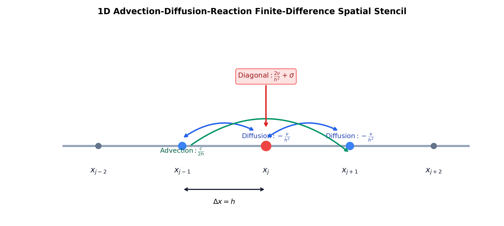
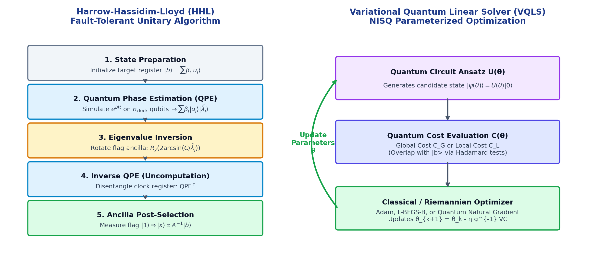

# Tutorial: Defining & Implementing New PDE Problems in `qpdesolver`

This guide explains how to formulate, discretize, and solve arbitrary Partial Differential Equations (PDEs) within the `qpdesolver` framework.

---

## 1. The Discretization Architecture

In `qpdesolver`, PDEs are represented through the [`PDEDiscretization`](../src/qpdesolver/problems/discretizations/base.py) abstract base class.

### 1.1. Core Requirements for Quantum Discretization
Because quantum states encode $2^n$ computational basis states on $n$ qubits:
1. **Power-of-2 Grid**: The number of spatial grid points $N$ must satisfy $N = 2^n$ (e.g., $N \in \{4, 8, 16, 32, \dots\}$).
2. **Matrix Dimension**: Spatial finite-difference or finite-element operators yield square matrices $A \in \mathbb{C}^{N \times N}$.
3. **Hermitian vs Non-Hermitian**:
   - Self-adjoint spatial operators (e.g. Laplacian, Helmholtz) yield real-symmetric or Hermitian matrices.
   - Non-Hermitian operators (e.g. advection, dissipative boundaries) are handled via automatic **Hermitian dilation**.

---

## 2. Implementing a Custom PDE Discretization

### Complete Example: 1D Steady Advection-Diffusion-Reaction Equation

Consider the classic steady advection-diffusion-reaction equation on the domain $\Omega = [0, L]$:
$$-\nu \frac{d^2 u}{dx^2} + c \frac{du}{dx} + \sigma u(x) = f(x)$$
where:
- $\nu > 0$ is the diffusion coefficient.
- $c \in \mathbb{R}$ is the convective velocity (advection).
- $\sigma \ge 0$ is the linear reaction rate.
- $f(x)$ is the external source term.

### Finite Difference Stencil
Using grid spacing $h = \Delta x$:
1. **Diffusion**: $\displaystyle -\nu \frac{u_{j-1} - 2u_j + u_{j+1}}{h^2}$
2. **Advection (Central)**: $\displaystyle c \frac{u_{j+1} - u_{j-1}}{2h}$
3. **Reaction**: $\displaystyle \sigma u_j$

Combining into operator $A = D + C + R$:
$$A_{j, j} = \frac{2 \nu}{h^2} + \sigma, \quad A_{j, j-1} = -\frac{\nu}{h^2} - \frac{c}{2h}, \quad A_{j, j+1} = -\frac{\nu}{h^2} + \frac{c}{2h}$$



### Complete Class Implementation

```python
from typing import Optional, Union
import numpy as np

from qpdesolver.core.registry import REGISTRY_DISCRETIZATIONS
from qpdesolver.problems.discretizations.base import PDEDiscretization
from qpdesolver.problems.linear_system import LinearSystem

@REGISTRY_DISCRETIZATIONS.register("advection_diffusion_reaction_1d")
class AdvectionDiffusionReaction1D(PDEDiscretization):
    """
    1D Steady Advection-Diffusion-Reaction operator:
        -nu * d^2 u / dx^2 + c * du / dx + sigma * u = f(x)
    """
    def operator(
        self,
        nu: float = 1.0,
        c: float = 0.5,
        sigma: float = 0.1,
    ) -> np.ndarray:
        N = self.n_points
        h = self.h
        h2 = h**2

        # Stencil coefficients
        diag_center = (2.0 * nu / h2) + sigma
        diag_sub = (-nu / h2) - (c / (2.0 * h))
        diag_super = (-nu / h2) + (c / (2.0 * h))

        A = (
            diag_center * np.eye(N)
            + diag_super * np.eye(N, k=1)
            + diag_sub * np.eye(N, k=-1)
        )

        if self.bc == "periodic" and N > 2:
            A[0, -1] = diag_sub
            A[-1, 0] = diag_super
        elif self.bc == "neumann":
            A[0, 0] += diag_sub
            A[-1, -1] += diag_super

        return A

    def system(
        self,
        rhs: np.ndarray,
        nu: float = 1.0,
        c: float = 0.5,
        sigma: float = 0.1,
        name: Optional[str] = None,
    ) -> LinearSystem:
        A = self.operator(nu=nu, c=c, sigma=sigma)
        sys_name = name or f"AdvDiffReact_nu={nu}_c={c}"
        return LinearSystem(
            A=A,
            b=rhs,
            name=sys_name,
            metadata={
                "pde": "advection_diffusion_reaction_1d",
                "nu": nu,
                "c": c,
                "sigma": sigma,
                "bc": self.bc,
                "h": self.h,
            },
        )
```

---

## 3. Working with the `LinearSystem` Abstraction

`LinearSystem` is the central problem representation for all quantum and classical solvers.

```python
# 1. Instantiate the discretization for 4 points (2 qubits)
pde = AdvectionDiffusionReaction1D(n_points=4, h=0.25, bc="dirichlet")

# 2. Define source term (e.g. Gaussian packet or point source)
b = pde.point_source(1)

# 3. Assemble the LinearSystem
system = pde.system(rhs=b, nu=1.0, c=0.2, sigma=0.0)

# 4. Inspect system properties
print("Qubits required:", system.n_qubits)
print("Condition number:", system.condition_number())
print("Is Hermitian?", system.is_hermitian())
```

### Pauli Operator Decomposition
To inspect the Hamiltonian representation for VQLS or Trotterized HHL:
```python
pauli_terms = system.pauli_decomposition()
for coeff, pauli_string in pauli_terms[:5]:
    print(f"  {coeff:+.4f} * {pauli_string}")
```

### Hermitian Dilation
If the advection velocity $c \ne 0$, the operator is non-Hermitian ($A \ne A^\dagger$). To run algorithms requiring Hermitian operators (like standard HHL), dilate the system:
```python
dilated_system = system.hermitian_dilation()
print("Dilated Qubits:", dilated_system.n_qubits)  # Original + 1
```

---

## 4. Solving Your Custom PDE

`qpdesolver` supports both fault-tolerant quantum algorithms (HHL) and NISQ variational algorithms (VQLS):



### 4.1. Exact Classical Solution (LU Decomposition)
```python
from qpdesolver.solvers.classical import ClassicalSolver

solver_c = ClassicalSolver()
res_c = solver_c.solve(system)
print("Classical Solution x:", res_c.x)
```

### 4.2. Harrow-Hassidim-Lloyd (HHL)
`HHLSolver` automatically dilates non-Hermitian systems:
```python
from qpdesolver.solvers.hhl import HHLSolver, HHLConfig

solver_hhl = HHLSolver(config=HHLConfig(n_clock=4))
res_hhl = solver_hhl.solve(system)

print(f"HHL Fidelity: {res_hhl.fidelity * 100:.2f}%")
print(f"HHL Residual: {res_hhl.residual:.2e}")
```

### 4.3. Variational Quantum Linear Solver (VQLS)
```python
from qpdesolver.solvers.vqls import VQLSSolver
from qpdesolver.ansatze import RealAmplitudes
from qpdesolver.optimizers.first_order import Adam

solver_vqls = VQLSSolver(
    ansatz=RealAmplitudes(layers=2),
    optimizer=Adam(lr=0.05),
    max_iter=60,
)
res_vqls = solver_vqls.solve(system)
print(f"VQLS Fidelity: {res_vqls.fidelity * 100:.2f}%")
```

---

## 5. Saving and Loading PDE Systems in HDF5

All linear systems can be persisted to and restored from standardized HDF5 files:

```python
from qpdesolver.io import save_linear_system, load_linear_system

# Save system (dense or CSR sparse)
save_linear_system("my_benchmarks.h5", system, group="adv_diff_4pt", overwrite=True)

# Reload system
loaded_system = load_linear_system("my_benchmarks.h5", group="adv_diff_4pt")
assert np.allclose(system.A, loaded_system.A)
```
