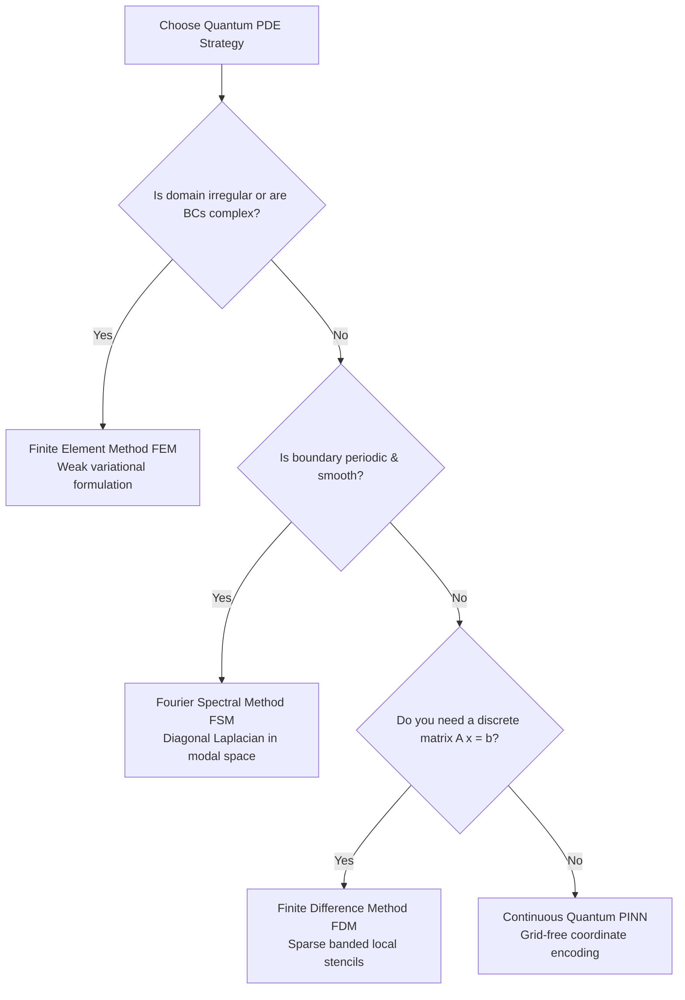

# Academic Guide: Discretization Strategies & Alternative Quantum PDE Representations

A central question in quantum scientific computing is: **How should continuous Partial Differential Equations (PDEs) be represented on a quantum processor?**

While conventional literature often defaults to standard Finite Difference stencils, the `qpdesolver` framework is designed to support **multiple spatial discretization paradigms** as well as **fundamentally non-discrete, grid-free representations**.

---

## 1. Comparative Taxonomy of Quantum PDE Strategies

| Strategy | Spatial Representation | Operator Matrix $A$ | Quantum Encoding | Best Quantum Algorithm | Key Advantage |
|:---|:---|:---|:---|:---|:---|
| **Finite Difference (FDM)** | Uniform grid points $x_j$ | Sparse, banded, tridiagonal | Amplitude encoding $|u\rangle = \sum u(x_j)|j\rangle$ | HHL (Trotter), VQLS | Simple local stencils, sparse Hamiltonian simulation |
| **Finite Element (FEM)** | Continuous piecewise polynomial basis $\phi_j(x)$ | Weak form: Stiffness $K$ & Mass $M$ ($(K - \omega^2 M) u = F$) | Amplitude encoding of nodal weights | HHL, VQLS | Natural handling of complex boundaries and variational physics |
| **Fourier Spectral (FSM)** | Global Fourier modes $e^{i k x}$ | **Exactly DIAGONAL** in Fourier space: $\operatorname{diag}(k^2)$ | Modal coefficients $|\hat{u}\rangle = \sum \hat{u}_k |k\rangle$ | HHL (exact QPE), QFT | No Trotter error, exact derivatives, exponential spectral convergence |
| **Quantum PINN (Q-PINN)** | Continuous coordinates $x \in \mathbb{R}$ | **None (No matrix $A$ or vector $b$)** | Continuous quantum coordinate network $u_\theta(x) = \langle 0\| U^\dagger(x, \theta) M U(x, \theta) \|0\rangle$ | Classical/Riemannian optimizers (Adam, QNG) | Completely mesh-free, solves at arbitrary resolution, no matrix inversion |
| **Graph Laplacian** | Relational nodes & graph edges | Combinatorial Laplacian $\mathcal{L} = D - W$ | Graph node amplitudes | HHL, VQLS | Solves diffusion and waves on irregular networks and molecules |

---

## 2. Strategy 1: Grid-Based Spatial Discretizations (FDM vs FEM)

In mesh-based approaches, the continuous field is represented by discrete values at nodal positions.

### 2.1. Finite Difference Method (FDM) — Strong Form
FDM replaces derivatives with point-wise Taylor expansions:
$$\frac{d^2 u}{dx^2}(x_j) \approx \frac{u_{j-1} - 2u_j + u_{j+1}}{h^2}$$
- **Operator Structure**: Sparse tridiagonal banded matrix.
- **Implementation in `qpdesolver`**: [`Helmholtz1D`](../src/qpdesolver/problems/discretizations/helmholtz.py), [`Poisson1D`](../src/qpdesolver/problems/discretizations/poisson.py).
```python
from qpdesolver.problems.discretizations import Helmholtz1D
fdm = Helmholtz1D(n_points=8, h=0.25, bc="dirichlet")
sys_fdm = fdm.system(rhs=fdm.point_source(2), omega=1.0)
```

### 2.2. Galerkin Finite Element Method (FEM) — Weak Form
Rather than satisfying the differential equation point-wise, FEM satisfies the integral weak variational formulation against test functions $v(x) \in H_0^1(\Omega)$:
$$\int_\Omega \frac{du}{dx} \frac{dv}{dx} \, dx - \omega^2 \int_\Omega m(x) u(x) v(x) \, dx = \int_\Omega s(x) v(x) \, dx$$
Expanding $u(x) = \sum_{j} u_j \phi_j(x)$ using piecewise linear hat functions yields the matrix generalized system:
$$\left( K - \omega^2 M \right) u = F$$
where:
- **Stiffness Matrix $K$**: $K_{ij} = \int \phi_i' \phi_j' dx = \frac{1}{h} \begin{pmatrix} 2 & -1 \\ -1 & 2 \end{pmatrix}$
- **Mass Matrix $M$**: $M_{ij} = \int \phi_i \phi_j dx = \frac{h}{6} \begin{pmatrix} 4 & 1 \\ 1 & 4 \end{pmatrix}$
- **Load Vector $F$**: $F_i = \int s(x) \phi_i(x) dx$

- **Implementation in `qpdesolver`**: [`FiniteElement1D`](../src/qpdesolver/problems/discretizations/finite_element.py).
```python
from qpdesolver.problems.discretizations import FiniteElement1D
fem = FiniteElement1D(n_points=8, h=0.25, bc="dirichlet")
sys_fem = fem.system(rhs=fem.point_source(2), omega=1.0)
```

---

## 3. Strategy 2: Modal & Spectral Expansions (Fourier Space)

Instead of discretizing physical coordinate space, **spectral methods** expand the solution into a truncated orthogonal function basis:
$$u(x) = \sum_{k=-N/2}^{N/2-1} \hat{u}_k e^{i k x}$$

### The Quantum Advantage of Fourier Space
In Fourier space (momentum representation), continuous spatial derivatives are **strictly algebraic multiplications**:
$$\frac{d^2}{dx^2} e^{i k x} = -k^2 e^{i k x}$$
Therefore, the continuous Laplacian $-d^2/dx^2$ is **strictly DIAGONAL**:
$$A_{\text{modal}} = \operatorname{diag}\left( k_0^2, k_1^2, \dots, k_{N-1}^2 \right) - \omega^2 I$$

### Connection to Quantum Fourier Transform (QFT)
Because the unitary Quantum Fourier Transform implements the basis transformation between physical coordinate space and modal momentum space in $\mathcal{O}(n^2)$ quantum gates:
$$|x\rangle \xrightarrow{\text{QFT}} |k\rangle$$
Solving the PDE in modal space completely eliminates Trotter discretization errors in HHL!

- **Implementation in `qpdesolver`**: [`FourierSpectral1D`](../src/qpdesolver/problems/discretizations/spectral.py).
```python
from qpdesolver.problems.discretizations import FourierSpectral1D
from qpdesolver.solvers.hhl import HHLSolver, HHLConfig

spectral = FourierSpectral1D(n_points=8, L=2.0 * np.pi)

# Diagonal linear system in modal space
sys_modal = spectral.system(rhs=[0, 1, 0, 0, 0, 0, 0, 0], omega=0.5, basis="modal")

# Solved with HHL with zero Trotter error
hhl = HHLSolver(config=HHLConfig(n_clock=4))
res_hhl = hhl.solve(sys_modal)
```

---

## 4. Strategy 3: Grid-Free Continuous Quantum Representation (Quantum PINN)

What if you do **not** want to discretize the domain into a linear system $A x = b$ at all?

In this modern machine learning paradigm, continuous fields are represented as **Continuous Quantum Coordinate Networks** (Kyriienko et al. 2021, Lubasch et al. 2020):
$$u_\theta(x) = \langle 0 | S^\dagger(x) W^\dagger(\theta) M W(\theta) S(x) | 0 \rangle$$
where:
1. $S(x)$ is a continuous coordinate feature map encoding continuous position $x \in \mathbb{R}$ into single-qubit rotations (e.g. $R_y(c \cdot x)$).
2. $W(\theta)$ is a parameterized variational ansatz circuit.
3. $M$ is an observable (e.g. Pauli $Z$).

### Continuous Residual Collocation Loss
Rather than solving matrix equations, we sample random continuous points $\{x_m\}_{m=1}^M \sim \mathcal{U}(0, L)$ and minimize the continuous differential residual:
$$\mathcal{L}(\theta) = \frac{1}{M} \sum_{m=1}^M \left| -\frac{d^2 u_\theta}{dx^2}(x_m) + \sigma u_\theta(x_m) - f(x_m) \right|^2 + \lambda_{\text{BC}} \left| u_\theta(x_{\text{boundary}}) - g \right|^2$$

Derivatives with respect to the continuous coordinate $x$ are calculated analytically via quantum parameter-shift rules:
$$\frac{du_\theta}{dx} = \frac{u_\theta(x + \frac{\pi}{2c}) - u_\theta(x - \frac{\pi}{2c})}{2}$$

### Solving via `qpdesolver` Optimizers
Because `qpdesolver` decouples optimizers from solvers via the `Objective` protocol, researchers can use `Adam`, `QuantumNaturalGradient`, or `ScipyOptimizer` to optimize continuous Quantum PINNs directly!

- **Executable Code**: See [`examples/10_alternative_pde_representations.py`](../examples/10_alternative_pde_representations.py).

---

## 5. Practical Guide: When to Choose Which Strategy?



### Summary of Quantum Tradeoffs
1. **For Trotterized HHL**: Use **Fourier Spectral Modal** representation, because diagonal matrices have zero Trotter error ($e^{i A t} = \prod_j e^{i \lambda_j t}$).
2. **For VQLS with Local Costs**: Use **Finite Difference (FDM)**, because banded local stencils map directly into local Pauli strings with shallow Hadamard tests.
3. **For High-Dimensional Multi-Scale PDEs**: Use **Continuous Quantum PINNs**, as they avoid the exponential curse of dimensionality of $N = 2^{d \cdot n}$ grid points.
