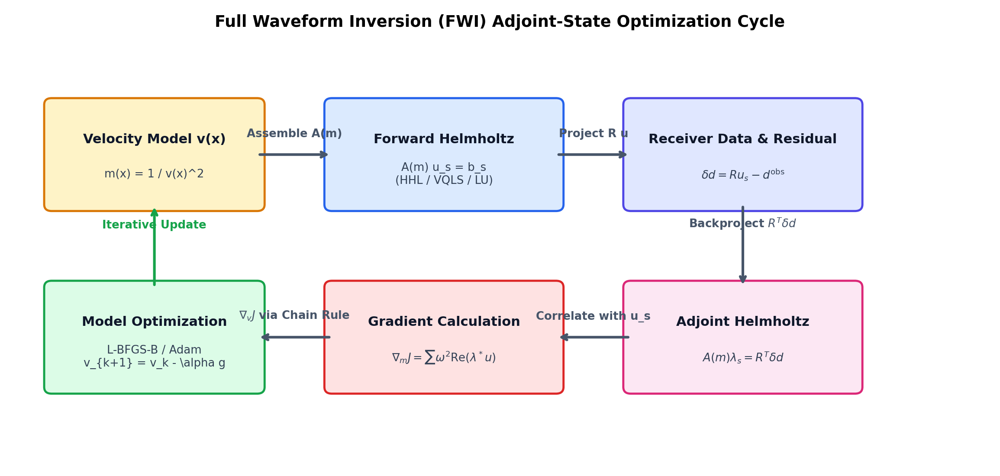
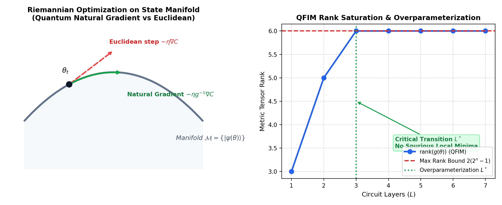

# Academic Theory & Mathematical Foundations: `qpdesolver`

This document provides a rigorous mathematical exposition of the quantum linear systems algorithms, Full Waveform Inversion (FWI) physics, and variational trainability geometry implemented in the `qpdesolver` framework.

---

## 1. Problem Formulation: Quantum Linear Systems Problem (QLSP)

Given a system of linear equations:
$$A x = b$$
where $A \in \mathbb{C}^{N \times N}$ is an invertible matrix of dimension $N = 2^n$ ($n$ qubits), and $b \in \mathbb{C}^N$ is a known vector.

In quantum scientific computing, the vector $b$ is encoded into an $n$-qubit quantum state:
$$|b\rangle = \frac{\sum_{i=0}^{N-1} b_i |i\rangle}{\|b\|_2}$$
The goal of the QLSP is to prepare the normalized quantum state proportional to the solution $x$:
$$|x\rangle = \frac{\sum_{i=0}^{N-1} x_i |i\rangle}{\|x\|_2} = \frac{A^{-1}|b\rangle}{\|A^{-1}|b\rangle\|_2}$$

Because quantum states are normalized, solving the QLSP directly yields $|x\rangle$. To recover the physical, unnormalized solution vector $x$, `qpdesolver` employs **least-squares norm recovery**:
$$\alpha = \frac{\langle A |x\rangle, |b\rangle}{\|A |x\rangle\|_2^2} \implies \tilde{x} = \alpha |x\rangle$$

---

## 2. Harrow-Hassidim-Lloyd (HHL) Algorithm

The HHL algorithm solves $A x = b$ in time logarithmic in the matrix dimension $N$, scaling as $\mathcal{O}(\kappa^2 s^2 \log(N) / \epsilon)$, where $\kappa = \lambda_{\max}/\lambda_{\min}$ is the condition number, $s$ is the matrix sparsity, and $\epsilon$ is the target error.

### 2.1. Circuit Architecture
HHL utilizes three registers:
1. **Target Register** ($n$ qubits): Holds state $|b\rangle$ initially, and outputs $|x\rangle$.
2. **Clock Register** ($n_{\text{clock}}$ qubits): Discretizes the eigenvalue spectrum into $M = 2^{n_{\text{clock}}}$ frequency bins during Quantum Phase Estimation (QPE).
3. **Ancilla Flag Qubit** (1 qubit): Implements conditional eigenvalue inversion via controlled $R_y$ rotation.

### 2.2. Algorithmic Steps
1. **State Preparation**: Initialize the target register into $|b\rangle$.
2. **Spectral Decomposition via QPE**:
   Decompose $|b\rangle$ into the eigenbasis $\{|u_j\rangle\}$ of Hermitian operator $A$:
   $$|b\rangle = \sum_{j} \beta_j |u_j\rangle, \quad A |u_j\rangle = \lambda_j |u_j\rangle$$
   Applying QPE with Hamiltonian simulation $U = e^{i A \Delta t}$ maps:
   $$\sum_{j} \beta_j |u_j\rangle |0\rangle^{\otimes n_{\text{clock}}} \xrightarrow{\text{QPE}} \sum_{j} \beta_j |u_j\rangle |\tilde{\lambda}_j\rangle$$
   where $\tilde{\lambda}_j$ is the $n_{\text{clock}}$-bit binary approximation of the normalized eigenvalue.
3. **Controlled Eigenvalue Inversion**:
   Rotate the ancilla qubit by angle $\theta(\tilde{\lambda}_j) = 2 \arcsin(C / \tilde{\lambda}_j)$:
   $$\sum_j \beta_j |u_j\rangle |\tilde{\lambda}_j\rangle \left( \sqrt{1 - \frac{C^2}{\tilde{\lambda}_j^2}} |0\rangle + \frac{C}{\tilde{\lambda}_j} |1\rangle \right)$$
   `qpdesolver` supports **two's-complement signed QPE grids**, handling both positive and negative eigenvalues without requiring unphysical energy shifts.
4. **Inverse QPE (Uncomputation)**:
   Apply $\text{QPE}^\dagger$ to disentangle the clock register from the target register:
   $$\left( C \sum_j \frac{\beta_j}{\lambda_j} |u_j\rangle \right) |0\rangle^{\otimes n_{\text{clock}}} |1\rangle + |\text{trash}\rangle |0\rangle$$
5. **Post-selection**:
   Measuring the ancilla flag qubit in state $|1\rangle$ collapses the target register onto $|x\rangle \propto A^{-1}|b\rangle$.

### 2.3. Hermitian Dilation for General Matrices
When $A$ is non-Hermitian or rectangular, `qpdesolver` automatically constructs the Hermitian dilated block system:
$$\mathcal{H} = \begin{pmatrix} 0 & A \\ A^\dagger & 0 \end{pmatrix}, \quad \mathbf{b} = \begin{pmatrix} b \\ 0 \end{pmatrix} \implies \mathcal{H} \begin{pmatrix} 0 \\ x \end{pmatrix} = \begin{pmatrix} b \\ 0 \end{pmatrix}$$

---

## 3. Variational Quantum Linear Solver (VQLS)

VQLS is a NISQ-compatible algorithm that formulates the linear system as an unconstrained variational optimization problem:
$$|\psi(\theta)\rangle = U(\theta) |0\rangle^{\otimes n}$$
where $U(\theta)$ is a parameterized quantum circuit (ansatz).

### 3.1. Cost Functions

#### A. Global Projector Cost ($C_G$)
The global cost measures the projector distance between $A |\psi(\theta)\rangle$ and $|b\rangle$:
$$C_G(\theta) = 1 - \frac{|\langle b | A | \psi(\theta)\rangle|^2}{\langle \psi(\theta) | A^\dagger A | \psi(\theta)\rangle}$$
- **Advantage**: Faithfully guarantees $C_G = 0 \iff |\psi(\theta)\rangle \propto A^{-1}|b\rangle$.
- **Disadvantage**: Suffers from **cost-induced barren plateaus** where $\operatorname{Var}[\partial_\theta C_G] \sim \mathcal{O}(2^{-2n})$, rendering deep or wide circuits untrainable.

#### B. Local Projector Cost ($C_L$)
To guarantee trainability for larger qubit counts ($n \ge 4$), `qpdesolver` provides the local projector cost (Cerezo et al. 2021):
$$C_L(\theta) = 1 - \frac{1}{n} \sum_{j=1}^n \frac{\langle \psi(\theta) | A^\dagger \left( I - |0\rangle\langle 0|_j \right) A | \psi(\theta)\rangle}{\langle \psi(\theta) | A^\dagger A | \psi(\theta)\rangle}$$
- **Advantage**: Gradients decay only polynomially with system size ($\operatorname{Var}[\partial_\theta C_L] \sim \mathcal{O}(1/\operatorname{poly}(n))$) for shallow circuits.

### 3.2. Quantum Natural Gradient (QNG) Optimization
Standard Euclidean gradient descent updates parameters along the coordinate axis:
$$\theta_{t+1} = \theta_t - \eta \nabla_\theta C(\theta_t)$$
However, parameter space is Riemannian under the **Fubini-Study metric tensor** $g_{ij}(\theta)$:
$$g_{ij}(\theta) = \operatorname{Re}\left( \langle \partial_i \psi(\theta) | \partial_j \psi(\theta)\rangle - \langle \partial_i \psi(\theta) | \psi(\theta)\rangle \langle \psi(\theta) | \partial_j \psi(\theta)\rangle \right)$$
The Quantum Natural Gradient updates along the steepest descent direction on the quantum state manifold:
$$\theta_{t+1} = \theta_t - \eta \left( g(\theta_t) + \epsilon I \right)^{-1} \nabla_\theta C(\theta_t)$$
where $\epsilon > 0$ is a Tikhonov regularization factor handling rank deficiency.

---

## 4. Full Waveform Inversion (FWI) Physics

Full Waveform Inversion is an imaging technique that reconstructs subsurface physical parameter distributions (e.g. acoustic velocity $v(x)$) by iteratively matching simulated seismic wavefields with field recordings.

### 4.1. Frequency-Domain Acoustic Wave Equation (1D Helmholtz)

In the frequency domain, the 1D acoustic wave equation with spatial domain $\Omega = [0, L]$ is governed by:
$$\left( -\frac{d^2}{dx^2} - \omega^2 m(x) \right) u(x, \omega) = s(x)$$
where:
- $\omega = 2 \pi f$ is the angular frequency.
- $m(x) = \frac{1}{v(x)^2}$ is the squared slowness (model parameter).
- $u(x, \omega)$ is the complex scalar pressure wavefield.
- $s(x)$ is the seismic source term (e.g., point source $\delta(x - x_s)$).

### 4.2. Finite-Difference Spatial Discretization
Discretizing the domain into $N = 2^n$ grid points with grid spacing $h = \Delta x$:
$$(L u)_j = \frac{-u_{j-1} + 2 u_j - u_{j+1}}{h^2}$$
The discrete Helmholtz operator $A(m, \omega) \in \mathbb{C}^{N \times N}$ is:
$$A(m, \omega) = L - \omega^2 \operatorname{diag}(m)$$
yielding the linear system:
$$A(m, \omega) u_s = b_s$$

### 4.3. Data Misfit & Adjoint-State Gradient Derivation
Let $R \in \mathbb{R}^{K \times N}$ be the receiver projection operator extracting wavefield values at receiver positions $x_r$:
$$d_{s, \omega}^{\text{pred}} = R u_{s, \omega}$$
The least-squares data misfit across all sources $s$ and frequencies $\omega$ is:
$$J(m) = \frac{1}{2} \sum_{s} \sum_{\omega} \| R u_{s, \omega} - d_{s, \omega}^{\text{obs}} \|_2^2$$

To calculate the gradient $\nabla_m J$ without computing the prohibitive full Frechet derivative matrix, we employ the **Adjoint State Method**:

1. Define the data residual vector:
   $$\delta d_{s, \omega} = R u_{s, \omega} - d_{s, \omega}^{\text{obs}}$$
2. Formulate the adjoint source:
   $$b_{s, \omega}^{\text{adj}} = R^T \delta d_{s, \omega}$$
3. Solve the adjoint Helmholtz PDE for the adjoint wavefield $\lambda_{s, \omega}$:
   $$A^\dagger \lambda_{s, \omega} = b_{s, \omega}^{\text{adj}}$$
   Since $A$ is real symmetric, $A^\dagger = A$.
4. Evaluate the gradient with respect to squared slowness $m$:
   Since $\frac{\partial A}{\partial m_i} = -\omega^2 e_i e_i^T$, the adjoint calculus gives:
   $$\frac{\partial J}{\partial m_i} = \sum_{s, \omega} \omega^2 \operatorname{Re}\left( \lambda_{s, \omega, i}^* u_{s, \omega, i} \right)$$
5. By the chain rule, the gradient with respect to velocity $v_i$ ($m_i = v_i^{-2}$):
   $$\frac{\partial J}{\partial v_i} = \frac{\partial J}{\partial m_i} \left( -\frac{2}{v_i^3} \right)$$

---

## 5. Trainability & Quantum Geometric Mechanics

### 5.1. Barren Plateau Theory
An optimization landscape exhibits a barren plateau when the variance of the partial derivative of the cost function vanishes exponentially with the number of qubits $n$:
$$\operatorname{Var}_{\theta \sim \text{Haar}}\left[ \frac{\partial C(\theta)}{\partial \theta_k} \right] \le F(n) \sim \mathcal{O}(2^{-\alpha n})$$
When this occurs, any gradient-based optimization requires an exponential number of quantum circuit measurements $\mathcal{O}(2^{\alpha n})$ simply to resolve the descent direction from statistical shot noise.

`qpdesolver` diagnoses barren plateaus by fitting:
$$\ln \operatorname{Var}[\partial_\theta C] = -\gamma n + \beta$$
If the decay rate $\gamma > 0.3$ with regression coefficient $R^2 > 0.75$, the circuit-cost pair is flagged as barren.

### 5.2. Dynamical Lie Algebra (DLA)
The Dynamical Lie Algebra $\mathfrak{g}$ generated by an ansatz circuit parameterized as $U(\theta) = \prod_k e^{-i \theta_k H_k}$ is defined by the real Lie closure of its generator set:
$$\mathfrak{g} = \operatorname{span}_{\mathbb{R}} \left\{ i H_k, [i H_j, i H_k], [i H_l, [i H_j, i H_k]], \dots \right\}$$
- **Subspace Exploration**: The dimension $\dim(\mathfrak{g})$ determines the dimensionality of the reachable unitary manifold.
- **Full Group**: If $\mathfrak{g} = \mathfrak{su}(2^n)$, then $\dim(\mathfrak{g}) = 4^n - 1$ (exponential).
- **Trainability Link (Fontana et al. 2023)**:
  $$\operatorname{Var}[\partial_\theta C] \sim \frac{1}{\dim(\mathfrak{g})}$$
  Ansätze with restricted polynomial DLA dimensions ($\dim(\mathfrak{g}) \sim \operatorname{poly}(n)$) are mathematically immune to barren plateaus.

### 5.3. Quantum Fisher Information Matrix (QFIM) Rank & Overparameterization
The QFIM $g(\theta)$ reflects the curvature and parameter redundancy of the variational ansatz.
- **Rank Saturation**: As the number of circuit layers $L$ increases, the rank $\operatorname{rank}(g(\theta))$ monotonically increases until reaching a saturation plateau $\operatorname{rank}_{\max} \le 2(2^n - 1)$.
- **Overparameterization Transition (Larocca et al. 2023)**: When circuit depth exceeds the critical overparameterization threshold $L \ge L^*$, all local minima become global minima, and convergence accelerates dramatically.

### 5.4. Entanglement & Expressibility
- **Meyer-Wallach Measure ($Q$)**: Quantifies the average linear entropy across all single-qubit subsystems:
  $$Q(|\psi\rangle) = \frac{4}{n} \sum_{j=1}^n D\left( \operatorname{Tr}_{\bar{j}}[|\psi\rangle\langle \psi|] \right) = \frac{4}{n} \sum_{j=1}^n \left( 1 - \operatorname{Tr}[\rho_j^2] \right)$$
  $Q = 0$ corresponds to pure product states; $Q = 1$ indicates maximal bipartite entanglement.
- **Expressibility ($\text{Expr}$)**: Evaluates the Kullback-Leibler (KL) divergence between the Haar-uniform state overlap probability distribution $P_{\text{Haar}}(F) = (N-1)(1-F)^{N-2}$ and the ansatz distribution $P_{\text{ansatz}}(F)$:
  $$\text{Expr} = D_{\text{KL}}\left( P_{\text{ansatz}}(F) \,\|\, P_{\text{Haar}}(F) \right)$$
  Lower values signify higher expressibility (better approximation of the full Hilbert space).
