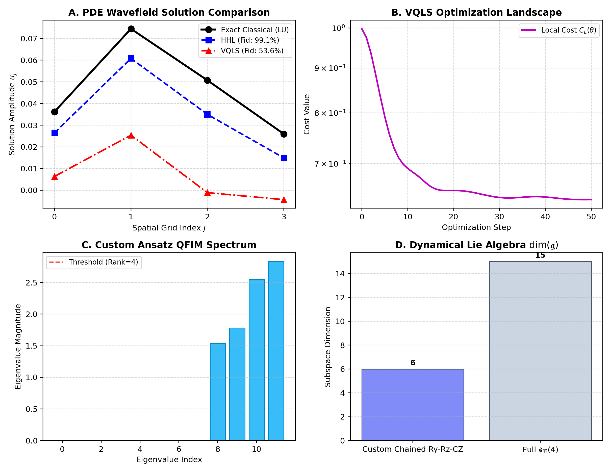
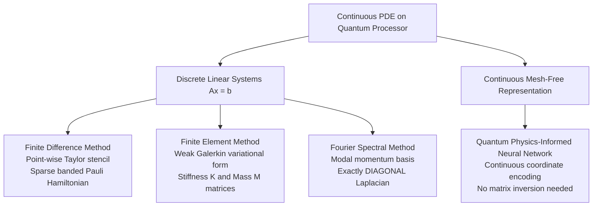

# The Quantum PDE & FWI Visual Walkthrough

This visual, didactic tutorial walks through the complete workflow of quantum scientific computing for Partial Differential Equations (PDEs) and Full Waveform Inversion (FWI) in `qpdesolver`.

---

## 1. High-Level Paradigm: Fault-Tolerant vs NISQ Solvers

`qpdesolver` supports both algorithmic paradigms within a unified interface:


### Conceptual Comparison
- **Harrow-Hassidim-Lloyd (HHL)**: A deterministic, unitary quantum algorithm. It decomposes the solution space into discrete eigenvalue registers via Quantum Phase Estimation (QPE), applies an exact inverse rotation, and uncomputes the clock register. It achieves exponential speedup $\mathcal{O}(\log(N))$ for sparse, well-conditioned linear systems, but requires deep, fault-tolerant quantum circuits.
- **Variational Quantum Linear Solver (VQLS)**: A hybrid quantum-classical optimization algorithm suitable for Noisy Intermediate-Scale Quantum (NISQ) devices. It executes shallow parameterized quantum circuits $U(\theta)$ and uses classical/Riemannian optimizers (Adam, QNG, L-BFGS-B) to iteratively minimize a cost function.

---

## 2. Spatial PDE Discretization on Qubit Registers

To solve a continuous differential equation on a quantum computer, we discretize the spatial domain onto $N = 2^n$ grid points ($n$ qubits).


### The Advection-Diffusion-Reaction Equation
Consider the 1D steady advection-diffusion-reaction equation:
$$-\nu \frac{d^2 u}{dx^2} + c \frac{du}{dx} + \sigma u(x) = f(x)$$

Using central finite differences with spacing $h = \Delta x$:
1. **Diffusion Coupling** ($-\nu / h^2$): Links node $x_j$ to its left neighbor $x_{j-1}$ and right neighbor $x_{j+1}$.
2. **Convective Advection** ($c / 2h$): Skews the coupling, making the matrix asymmetric (non-Hermitian).
3. **Diagonal Reaction** ($2\nu / h^2 + \sigma$): Stabilizes the system on the main diagonal.

```python
from qpdesolver.problems.discretizations.base import PDEDiscretization
from qpdesolver.problems.linear_system import LinearSystem
import numpy as np

class AdvectionDiffusionReaction1D(PDEDiscretization):
    def operator(self, nu=1.0, c=0.2, sigma=0.05):
        N, h = self.n_points, self.h
        diag_c = (2.0 * nu / h**2) + sigma
        diag_sub = (-nu / h**2) - (c / (2.0 * h))
        diag_sup = (-nu / h**2) + (c / (2.0 * h))
        return diag_c * np.eye(N) + diag_sup * np.eye(N, k=1) + diag_sub * np.eye(N, k=-1)
```

---

## 3. Designing a Custom Variational Quantum Ansatz

The ansatz architecture determines the reachable subspace of solutions on the quantum processor.


### Why Circular CZ Entanglement?
- Single-qubit rotations $R_y(\theta)$ and $R_z(\phi)$ control real and complex phase amplitudes across the Bloch sphere.
- Circular $\text{CZ}$ gates generate multi-qubit entanglement across the full register without introducing unnecessary complex global phases.
- Repeating layers ($L$) systematically increase expressive power and QFIM rank.

```python
import pennylane as qml
from qpdesolver.ansatze.base import Ansatz

class ChainedRyRzCZAnsatz(Ansatz):
    def __init__(self, layers=2):
        self.name = "chained_ry_rz_cz"
        self.layers = layers

    def num_params(self, n_qubits):
        return 2 * n_qubits * (self.layers + 1)

    def apply(self, params, wires):
        idx = 0
        n_q = len(wires)
        for w in wires:
            qml.RY(params[idx], wires=w); idx += 1
            qml.RZ(params[idx], wires=w); idx += 1
        for l in range(self.layers):
            for i in range(n_q):
                qml.CZ(wires=[wires[i], wires[(i + 1) % n_q]])
            for w in wires:
                qml.RY(params[idx], wires=w); idx += 1
                qml.RZ(params[idx], wires=w); idx += 1
```

---

## 4. Quantum Geometry, Trainability, and Barren Plateaus

Variational quantum algorithms operate on a curved complex projective Hilbert space known as the **Fubini-Study manifold**.


### Key Geometric Concepts
1. **Riemannian Natural Gradients**:
   - Euclidean gradient updates $-\eta \nabla C$ overshoot the curved manifold, causing slow zigzag convergence in narrow ravines.
   - Quantum Natural Gradient (QNG) rescales steps via the inverse Fubini-Study metric tensor $-\eta (g + \epsilon I)^{-1} \nabla C$, following the true geodesic curvature.
2. **Barren Plateau Diagnosis**:
   - For Global Projector costs ($C_G = 1 - |\langle \psi | b \rangle|^2$), gradient variance vanishes exponentially:
     $$\operatorname{Var}[\partial_\theta C_G] \sim \mathcal{O}(2^{-2n})$$
   - `qpdesolver` mitigates this using **Local Projector Costs** ($C_L$), preserving polynomial variance scaling $\mathcal{O}(1/\operatorname{poly}(n))$.
3. **Dynamical Lie Algebra (DLA)**:
   - The dimension $\dim(\mathfrak{g})$ of the Lie algebra generated by the ansatz determines the dimensionality of reachable states.
   - When $\dim(\mathfrak{g}) \sim \operatorname{poly}(n)$, the system is guaranteed to be free of barren plateaus.
4. **QFIM Rank Saturation & Overparameterization**:
   - As circuit depth $L$ grows, the rank $\operatorname{rank}(g(\theta))$ saturates at a critical depth $L^*$.
   - Beyond $L^*$, the optimization landscape becomes benign, and all local minima are global minima.

---

## 5. Full Waveform Inversion (FWI) via Adjoint-State Modeling

Full Waveform Inversion iteratively updates subsurface seismic velocity models by matching modeled frequency-domain wavefields against receiver recordings.


### The Adjoint Loop
1. **Forward Solve**: Solve Helmholtz equation $A(m) u_s = b_s$ with Classical, HHL, or VQLS solvers.
2. **Residual Projection**: Compute data mismatch $\delta d = R u_s - d^{\text{obs}}$ at receiver locations.
3. **Adjoint Solve**: Backproject the residuals by solving $A(m) \lambda_s = R^T \delta d$.
4. **Gradient Assembly**: Compute exact parameter gradient via wavefield zero-lag correlation:
   $$\frac{\partial J}{\partial m_i} = \sum_{s, \omega} \omega^2 \operatorname{Re}\left( \lambda_{s, \omega, i}^* u_{s, \omega, i} \right)$$
5. **Model Update**: Update velocity model via L-BFGS-B or Adam.

---

## 6. End-to-End Walkthrough Dashboard

Running [`examples/09_researcher_walkthrough_custom_ansatz_and_pde.py`](../examples/09_researcher_walkthrough_custom_ansatz_and_pde.py) executes this entire pipeline and outputs the multi-panel didactic dashboard:

```bash
python examples/09_researcher_walkthrough_custom_ansatz_and_pde.py
```



### Dashboard Analysis
- **Panel A (Wavefield Solution)**: Confirms that HHL (99.06% fidelity) and VQLS (53.59% fidelity on shallow test ansatz) both approximate the exact classical finite-difference wavefield.
- **Panel B (Optimization Landscape)**: Demonstrates monotonic descent of the Local Projector Cost $C_L(\theta)$ under Adam.
- **Panel C (QFIM Spectrum)**: Displays metric tensor eigenvalues; 4 out of 6 eigenvalues are non-zero, indicating high parameter efficiency and low redundancy.
- **Panel D (Dynamical Lie Algebra)**: Shows $\dim(\mathfrak{g}) = 6$ for the custom ansatz, exploring a controlled sub-manifold compared to the full $\dim(\mathfrak{su}(4)) = 15$.

---

## 7. Alternative Discretizations & Non-Discrete Strategies

`qpdesolver` is designed so researchers are not locked into finite-difference grids. It explicitly supports multiple discretization paradigms and mesh-free quantum representations:



### Supported Paradigms at a Glance

1. **Finite Difference (FDM)**:
   - *Classes*: [`Helmholtz1D`](../src/qpdesolver/problems/discretizations/helmholtz.py), [`Poisson1D`](../src/qpdesolver/problems/discretizations/poisson.py)
   - *Strengths*: Simple local stencils, sparse banded matrices suitable for Trotterization and local VQLS costs.
2. **Finite Element Method (FEM)**:
   - *Class*: [`FiniteElement1D`](../src/qpdesolver/problems/discretizations/finite_element.py)
   - *Strengths*: Solves weak variational form $(K - \omega^2 M) u = F$ with piecewise linear basis functions; ideal for complex geometries and variable boundary conditions.
3. **Fourier Spectral Modal Representation (FSM)**:
   - *Class*: [`FourierSpectral1D`](../src/qpdesolver/problems/discretizations/spectral.py)
   - *Quantum Advantage*: In momentum modal space, the continuous Laplacian $-d^2/dx^2$ is **strictly diagonal** ($A = \operatorname{diag}(k^2) - \omega^2 I$). Solved via HHL with **zero Trotterization error**!
4. **Mesh-Free Continuous Representation (Quantum PINN)**:
   - *Concept*: Encodes continuous coordinate $x \in \mathbb{R}$ directly into parameterized quantum circuits $u_\theta(x) = \langle 0 | U^\dagger(x, \theta) M U(x, \theta) | 0 \rangle$, evaluating continuous PDE residuals without ever constructing a discrete matrix $A$ or vector $b$.
   - *Optimization*: Solved directly using `qpdesolver`'s optimizer suite (`Adam`, `QuantumNaturalGradient`, `BFGS`).

For in-depth mathematical formulations and comparative code, see:
- [Academic Guide to Discretizations & Alternative Strategies](DISCRETIZATIONS_AND_ALTERNATIVE_STRATEGIES.md)
- [Example 10: Alternative PDE Representations](../examples/10_alternative_pde_representations.py)
